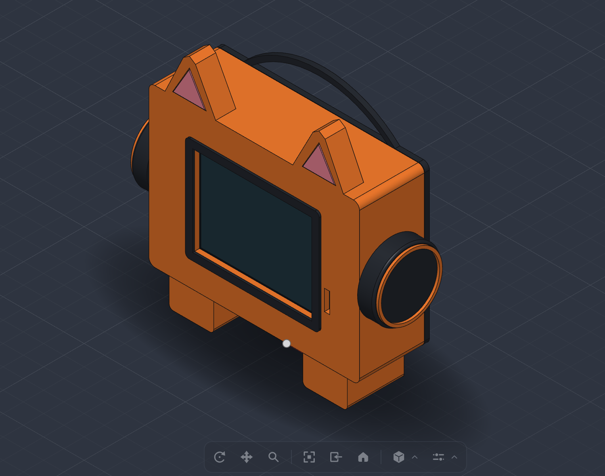
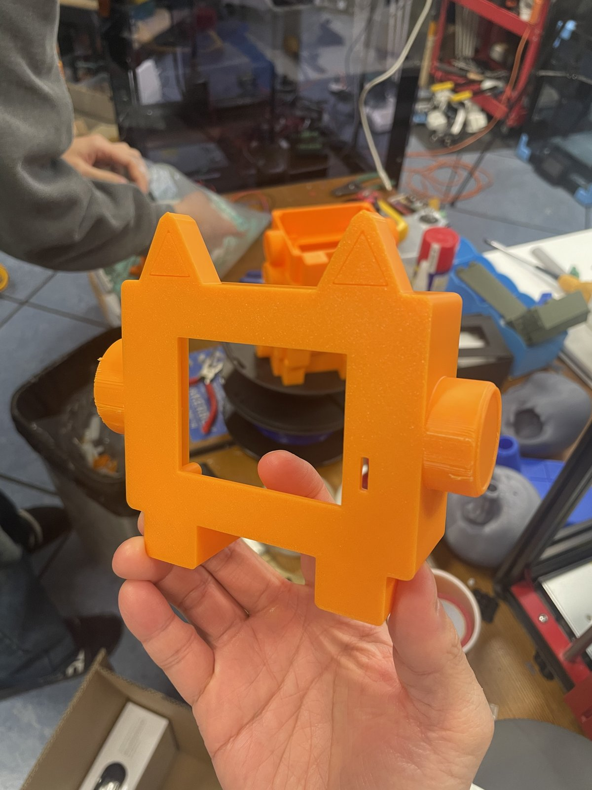
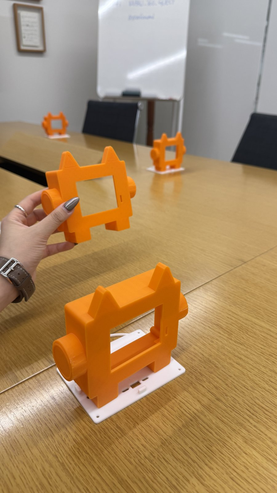

# Desk Buddies case

Cat-ear case for the Freenove ESP32-S3 Display 2.8" (ES3C28P). Modeled in SolidCraft, printed in orange PLA. STL files: coming soon.

| | |
|---|---|
|  |  |

## Board dimensions (ES3C28P)

| Item | Value |
|---|---|
| PCB | 86.00 x 50.00 mm, 1.6 mm thick |
| LCD + touch outline | 69.20 x 50.00 mm |
| Visible area (VA) | 58.05 x 43.60 mm |
| Active area (AA) | 57.60 x 43.20 mm (320 x 240 px) |
| Front stack above PCB | 4.30 mm = 0.5 adhesive + 2.3 LCD + 0.5 adhesive + 1.0 touch |
| Max total thickness | 10.60 mm |
| Mounting holes | 78 x 42 mm spacing, diameter 3.20 mm |
| VA center offset | 3.015 mm horizontally from the PCB center |

## Case design values

| Item | Value |
|---|---|
| Case window | 58.85 x 44.40 mm (VA + 0.4 mm on each side) |
| Board guide clearance | 0.5 mm per side |

## Print

- Material: orange PLA.
- STL files: coming soon.
