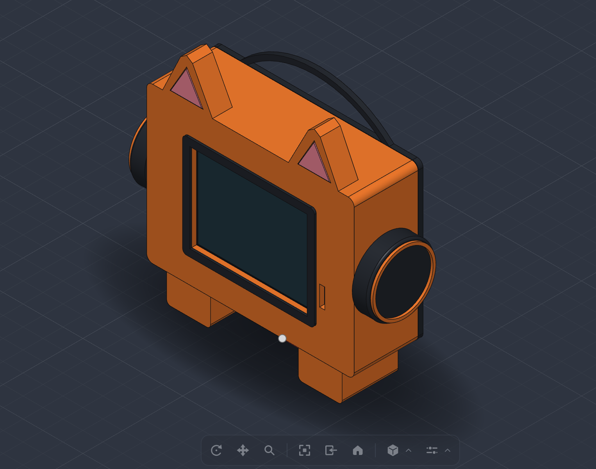
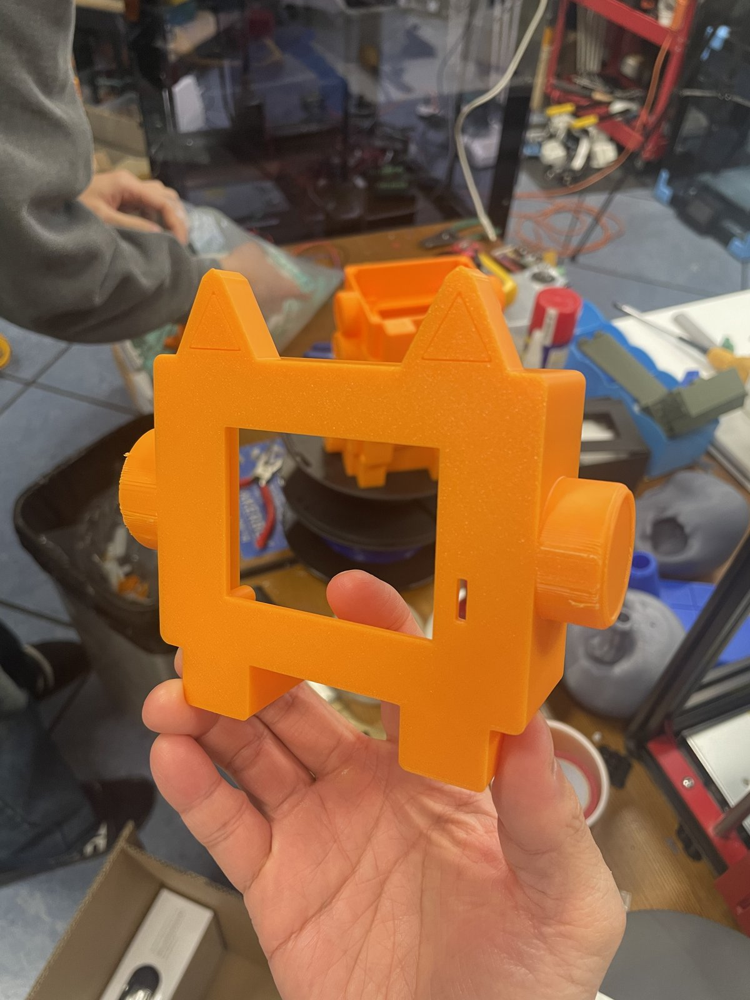
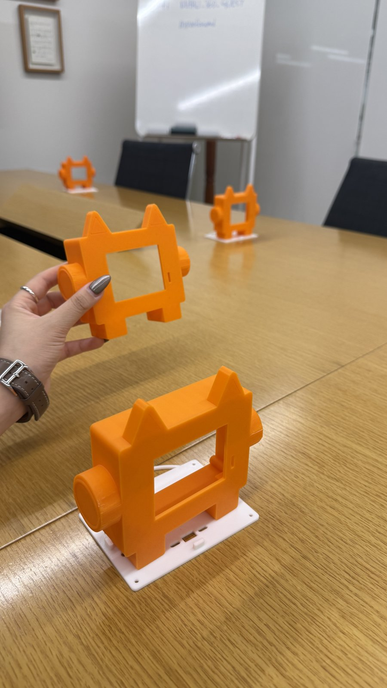

# Desk Buddies: Build Guide

Build two small cat-eared pixel screens for two desks. They show your pets and your baby-to-be, pass messages and high-fives between each other over your home Wi-Fi, and show what your AI coding assistant is doing right now.

Follow the parts in order. Each part tells you what you need, what to do, what you should see, and what to try if it does not work.



> **Release status.** The `firmware/` folder is being prepared for release; until then, Part 3 and Part 4 describe the process, and the commands in them are the ones I use on my own copy. Everything on the computer side (Parts 6, 7 and 10), the case dimensions (Part 2) and the pixel art (Part 9) are in this repo and work today. Items marked **(to be added)** are not published yet.

## Contents

0. Overview: how the pieces fit
1. Parts and tools
2. Print the cat-ear case
3. Build and flash the firmware
4. First boot and Wi-Fi setup
5. Pair two boards
6. Connect your AI coding assistant
7. Usage limit and weather display
8. Optional: baby diary, ultrasound, health, birth prep
9. Make it your family: art and sounds
10. Check the screen remotely, and troubleshooting
11. Credits and licenses

---

## Part 0. Overview: how the pieces fit

You build two identical boards. Each board is a small computer with a touch screen. They talk to each other directly over your home Wi-Fi, with no cloud account and no pairing step.

```
  Computer A (Claude Code)                 Computer B (Codex)
  hooks -> host/ scripts                   hooks -> host/ scripts
        |  HTTP POST /usage                      |  HTTP POST /usage
        v                                        v
   +-----------+   UDP broadcast, port 47801   +-----------+
   |  Board A  | <---------------------------> |  Board B  |
   | (desk A)  |  messages, replies, high-five | (desk B)  |
   +-----------+  visit, poke                  +-----------+
        ^                                            ^
        |  HTTPS GET, about every 10 minutes (optional)
        +------------- Your diary server ------------+
                       (baby diary, ultrasound, health, birth prep)
```

Three data paths, from simplest to most optional:

1. **Board to board.** UDP broadcast on port `47801` on the same Wi-Fi. This works as soon as both boards are on the same network.
2. **Computer to board.** Your AI coding tool runs a hook (a small script) on each event. The script sends a JSON message to the board's `/usage` address. This is how the board knows "working", "waiting for approval", "error", and your usage limit.
3. **Server to board (optional).** The board fetches JSON from a server you run. Skip this if you only want the pets and the assistant status.

**Time and skill.** Plan one weekend. You need to be comfortable running commands in a terminal. You do not need to write code.

---

## Part 1. Parts and tools

**Parts (for two boards)**

| Qty | Item | Notes |
|---|---|---|
| 2 | Freenove ESP32-S3 Display 2.8" (model ES3C28P) | 320x240 touch LCD, Wi-Fi, speaker. Must be the touch version |
| 2 | USB-C cable (data, not charge-only) | One per board, for flashing and power |
| 2 | 5 V USB power supply | Any phone charger works |
| about 100 g | Orange PLA filament | Any color works; orange is what the photos show |

**Tools**

- A 3D printer (FDM) and a slicer.
- A computer with macOS (tested) or Linux, with a terminal.
- Python 3.
- A 2.4 GHz Wi-Fi network at home. ESP32 boards do not join 5 GHz-only networks.
- Optional: `ffmpeg` (Part 9, sounds), Pillow (`pip install pillow`, Part 10 screen capture).

You do not need to solder anything.



---

## Part 2. Print the cat-ear case

**What you need:** a 3D printer, orange PLA, the board, and the dimensions below.

STL files: `case/stl/` **(to be added)**. Until they are published, you can model your own case from the numbers in this part, or print any 2.8" ES3C28P case you like.

**Dimensions of the board (ES3C28P)**

| Item | Value |
|---|---|
| PCB | 86.00 x 50.00 mm, 1.6 mm thick |
| LCD + touch outline | 69.20 x 50.00 mm |
| Visible area | 58.05 x 43.60 mm |
| Active area | 57.60 x 43.20 mm (320 x 240 px) |
| Front stack above PCB | 4.30 mm (0.5 adhesive + 2.3 LCD + 0.5 adhesive + 1.0 touch) |
| Max total thickness | 10.60 mm |
| Mounting holes | 78 x 42 mm spacing, diameter 3.20 mm |
| Visible-area center offset | 3.015 mm sideways from the PCB center |

**Design values used for my case**

| Item | Value |
|---|---|
| Screen window in the case | 58.85 x 44.40 mm (visible area + 0.4 mm each side) |
| Board guide clearance | 0.5 mm per side |

**Print settings (recommendations, not tested limits)**

- Material: PLA, orange.
- Layer height 0.2 mm, 2 to 3 walls, 15 to 20 % infill.
- Print the front shell with the screen window facing the bed or with supports for the ears, depending on how your STL is oriented.
- Print one case per board.

**Steps**

1. Download the STL files from `case/stl/` once they are added, or use your own model made from the table above.
2. Slice and print one case for each board.
3. Remove supports and test the fit with the bare board before you flash anything. The board should slide in without force.
4. Leave the case open for now. You will flash the board through its USB-C port in Part 3, and it is easier with the board outside the case.

**Assembly (after Part 4 works)**

1. Hold the case with the screen window facing you.
2. Slide the board in from the back, screen side toward the window, until the LCD sits flat behind the window.
3. Close the back and plug in USB-C for power.



**You should see:** the screen centered in the window, with no black bezel showing on any side.

**Tip.** If the screen looks off-center, check the 3.015 mm offset in the table. The visible area is not centered on the PCB.

> My own build runs the USB-C cable out through an extension flat cable inside the case. For flashing or reading logs, I take the extension out and plug the board in directly. A standard case without an extension is fine for power only.

---

## Part 3. Build and flash the firmware

> **The `firmware/` folder is being prepared for release; until then this part describes the process.** The firmware is based on [xiaozhi-esp32](https://github.com/78/xiaozhi-esp32) (MIT). It contains third-party character art that cannot be republished, so I am separating it before release. The steps below are the ones I use on my own copy.

**What you need:** the board connected to your computer with a USB-C data cable, and ESP-IDF installed.

**Steps**

1. **Install ESP-IDF.** The firmware base targets ESP-IDF v6.0 or later (v6.0.2 recommended by the base project). Follow Espressif's official install guide, and note where you installed it. I install to `~/esp/esp-idf`.
2. **Open a terminal and load the ESP-IDF environment** (repeat in every new terminal):

   ```bash
   . ~/esp/esp-idf/export.sh
   ```

3. **Go to the firmware folder and build.** The chip is an ESP32-S3, and the firmware's saved configuration is already set for the Freenove 2.8" display board.

   ```bash
   cd firmware
   idf.py build
   ```

4. **Find the serial port** on macOS:

   ```bash
   ls /dev/cu.usbmodem*
   ```

5. **Flash.** Replace the port with yours:

   ```bash
   idf.py -p /dev/cu.usbmodem1101 -b 460800 flash
   ```

   If the flash stops halfway, run it again at a lower speed (for example `-b 115200`).

**You should see:** the build ends with a firmware file at `build/xiaozhi.bin`, and the flash log contains `Hash of data verified` five times. Then the board reboots and the screen turns on.

**Tips**

- `idf.py build` can report success even when it failed. Check the log for ` error:` or `ninja: build stopped`, and check that `build/xiaozhi.bin` has a new timestamp.
- Do not erase the whole flash storage after the board has Wi-Fi saved on it. It also deletes the Wi-Fi settings.
- Opening a serial monitor on the board's USB port resets the board. Wait a few seconds and read again if the log looks empty.
- If the screen stays black after flashing, unplug and replug the USB cable (a real power cycle) before trying anything else.
- Some builds compile the character art for a specific "pack" through a setting in the build configuration. See Part 9 and `tools/gen_pack.py`.

---

## Part 4. First boot and Wi-Fi setup

**What you need:** a flashed board, a phone or laptop, and your home Wi-Fi name and password (2.4 GHz).

On the first boot the board has no Wi-Fi saved, so it starts its own temporary Wi-Fi hotspot and shows a three-step "first time setup" guide on its screen.

**Steps**

1. Power the board with USB-C. Wait for the setup guide on the screen.
2. On your phone, open the Wi-Fi list and join the open hotspot named `Xiaozhi-` followed by four characters (for example `Xiaozhi-5855`; yours will differ).
3. Open a browser and go to:

   ```
   http://192.168.4.1
   ```

4. Pick your home Wi-Fi from the list, enter the password, and save.
5. The board leaves setup mode and joins your Wi-Fi. The setup guide disappears.

**You should see:** the idle screen with a character walking over a background, and the usage limit cells in the top corners.

**Tips**

- If the setup page does not open, check that your phone is still on the `Xiaozhi-` hotspot (some phones switch back to a network with internet).
- A wrong password drops the board back to setup mode after a timeout, and the guide returns.
- Repeat Part 4 for the second board.
- Give each board a fixed IP address in your router's settings if you can. It makes Part 6 more reliable.

---

## Part 5. Pair two boards

**What you need:** both boards flashed and on the **same** Wi-Fi network.

There is no pairing step. Each board sends a small UDP packet to the whole network on port `47801`, and any Desk Buddies board on the same network receives it.

**Steps**

1. Power both boards on the same Wi-Fi.
2. On board A, tap the heart at the bottom left of the idle screen.
3. Look at board B: a big heart appears for about four seconds, with a meow.
4. On board A, check the top-left toast. It changes from `POKE!` to `SENT` when board B confirmed.
5. **Send a message.** Press and hold the heart for about 0.8 seconds. A phrase panel opens. Tap a phrase. Board B shows the phrase with three reply buttons.
6. **High-five.** Tap the heart on both boards within 10 seconds of each other. Both screens show "high-five".
7. **Visit.** In the phrase panel, use the "go" row to send your character over to the other board.

**You should see:** `SENT` on the sender, a heart on the receiver.

**Troubleshooting**

- `NO PEER` means no board answered within 1.5 seconds. Check that both boards are on the same Wi-Fi.
- Guest Wi-Fi and some mesh networks block devices from seeing each other (called client isolation). Turn that off, or use the main network.
- Both boards need firmware of the same generation. Flash both boards at the same time.

**Test without touching the screen** (replace `<BOARD_IP>` with your board's address, see Part 6 for how to find it):

```bash
curl -d '{"poke":2}'    http://<BOARD_IP>/usage    # send a poke through the real path
curl -d '{"poke_rx":3}' http://<BOARD_IP>/usage    # show a received poke locally
```

---

## Part 6. Connect your AI coding assistant

**What you need:** a computer on the same Wi-Fi as the board, Python 3, this repo downloaded, and Claude Code and/or Codex installed.

The scripts in `host/` find the board, install hooks (so your assistant reports its state), and push the state to the board's `/usage` address. Every hook runs in the background and cannot slow down your assistant.

**Steps**

1. Open a terminal in the repo folder.
2. **One-line setup.** This finds the board, installs hooks for Claude Code, and installs hooks for Codex if Codex is present:

   ```bash
   python3 host/setup.py
   ```

   It backs up your existing settings first, only adds entries, and gives the same result when run again.

3. Or do it step by step:

   ```bash
   python3 host/find_board.py        # finds the board on your Wi-Fi, writes host/board.json
   python3 host/install_claude.py    # Claude Code hooks + statusline tee in ~/.claude/settings.json
   python3 host/install_hooks.py     # Codex hooks in ~/.codex/hooks.json
   ```

4. Useful options (all exist in the scripts):

   ```bash
   python3 host/setup.py --dry-run                      # show what would change, write nothing
   python3 host/setup.py --config-dir ~/.claude-work    # another Claude Code config folder (repeatable)
   python3 host/setup.py --skip-board                   # skip the board search
   python3 host/install_claude.py --remove              # take the hooks out again
   python3 host/install_hooks.py --remove
   ```

5. **If the board is not found automatically**, you can tell the scripts its address yourself. `find_board.py` looks for the board by its MAC address (a unique hardware address, printed on your router's device list). Set it, then run again:

   ```bash
   export CLAUDEBOT_BOARD_MAC=<your board's MAC address>
   python3 host/find_board.py --probe
   ```

   Or skip the search and point the scripts at the board directly:

   ```bash
   export CLAUDEBOT_BOARD_URL=http://<BOARD_IP>/usage
   ```

   `host/board.json` holds the saved address (and optional `lat` / `lon` for weather).

6. Restart Claude Code (or Codex), and send it a prompt.

**You should see:** the character on the board reacts. While the assistant works, the board shows a working animation with the tool name. When the assistant waits for your approval, the screen border pulses. After an error it shows an error face for 5 seconds. When a turn finishes it shows a "done" face for 8 seconds, then returns to idle.

| State | Meaning on the board |
|---|---|
| `working` | A tool is running |
| `thinking` | The assistant is reading your prompt |
| `permission` | Waiting for you (stays until you answer, 15 minute cap) |
| `error` | A tool failed (back to working after 5 s) |
| `juggling` | A sub-agent is running |
| `done` | Turn finished (back to idle after 8 s) |
| `sleeping` | The board sleeps after 10 idle minutes |

**Notes**

- The hooks use these events: SessionStart, SessionEnd, UserPromptSubmit, PreToolUse, PostToolUse, PostToolUseFailure, PermissionRequest, Notification, SubagentStart, SubagentStop and Stop. Each is registered as asynchronous with a 5 second timeout.
- Codex has no `PostToolUseFailure` or `Notification` event, so `claude_state.py` reads the Codex session log to detect errors.
- **Check the hook without the assistant:** send a state by hand.

  ```bash
  curl -m 8 -X POST http://<BOARD_IP>/usage -d '{"state":"working","ctx":"test"}'
  ```

- The host scripts that search your network (`find_board.py`) use macOS command-line tools (`arp`, `route`, `ifconfig`). On Linux, write the board address into `host/board.json` yourself, as `{"url": "http://<BOARD_IP>/usage"}`. I tested the host side on macOS only.
- Run the included tests with `cd host && python3 -m unittest discover -p "test_*.py"`.

**Troubleshooting**

- The board shows only the idle screen. The hooks run but cannot reach the board. Look at the logs: `tail /tmp/claudebot-state.log /tmp/claudebot-push.log`. `No route to host` usually means the address is wrong or your computer has not resolved the board yet. Ping the board a few times, then run `python3 host/find_board.py --rescan`.
- On macOS, a Python installed from python.org may be blocked from the local network. The installers choose a Python that can reach the board and write its full path into the hooks. To choose one yourself, add `--python <path>` to the installer, or set `CLAUDEBOT_HOOK_PYTHON`.
- If you moved to another Wi-Fi, the board joins the saved network by itself. Run `python3 host/find_board.py` to refresh the address.

---

## Part 7. Usage limit and weather display

**What you need:** Part 6 done.

**Usage limit.** The top corners of the idle screen show how much of your 5-hour and weekly limit is left, with the time until reset. For Claude Code, the limits come from the statusline data. `install_claude.py` adds a small `tee` command in front of your existing statusline command, which saves a copy of the data to a file in `/tmp`. Your own statusline keeps working. For Codex, `host/codex_usage.py` reads the limits from the Codex session logs in `~/.codex/sessions`, and no statusline is needed.

A `~` after a label (for example `5h~`) means the number is the last one received and is more than 15 minutes old.

The cost columns (dollars and tokens used) need a usage-counting module that is not part of this repo, so Claude Code cost figures are not available from this repo alone. Codex shows token counts. See `host/push_usage.py` if you want to wire in your own counter.

**Weather.** The board fetches weather from [Open-Meteo](https://open-meteo.com/) by itself every 30 minutes, and your character changes outfit and weather particles (rain, snow, and more). You can also push weather from your computer on a schedule:

1. Test without a board:

   ```bash
   python3 host/push_weather.py --dry-run
   ```

2. Set your location by adding `lat` and `lon` to `host/board.json`, for example `{"lat": 37.5, "lon": 127.0}`. Without it the default is Seoul.
3. On macOS, install the scheduled job. First open `host/com.claudebot.weather.plist` and replace `/ABSOLUTE/PATH/TO/desk-buddies/host/push_weather.py` with the real path on your computer. Then:

   ```bash
   cp host/com.claudebot.weather.plist ~/Library/LaunchAgents/
   launchctl load ~/Library/LaunchAgents/com.claudebot.weather.plist
   ```

   The job runs once at load and then every 30 minutes (`StartInterval` 1800). Its log is `/tmp/claudebot-weather.log`.

4. You can also set the board's weather location directly (replace the numbers with yours):

   ```bash
   curl -d '{"geo":{"lat":37.5,"lon":127.0}}' http://<BOARD_IP>/usage
   ```

**You should see:** a weather icon and temperature on the top bar, and rain or snow particles when the weather is wet.

**Tip.** To try a look without waiting for real weather, send it by hand:

```bash
curl -d '{"weather":{"kind":"rain","temp":18,"night":false}}' http://<BOARD_IP>/usage
```

`kind` can be `rain`, `snow`, `clear`, `cloud` or `partly`.

---

## Part 8. Optional: baby diary, ultrasound, health, birth prep

**What you need:** a web server you control that can answer HTTPS requests with JSON. The server I use is my own app and is not part of this repo, so this part describes only what the board expects, so you can build or adapt your own.

**What the board does.** About every 10 minutes it sends an HTTPS GET to your server's `/api/board` address with an `Authorization: Bearer <token>` header. When you open one of the menu items, it fetches `/api/board?part=ultrasound`, `?part=health` or `?part=prep` (skipping a part it fetched within the last 5 minutes). Photos are fetched as small JPEG thumbnails from addresses that your server signs.

**Rules for your server**

- Use `https` only. The board will not take a plain `http` address.
- The response to `?part=<name>` must include `"part": "<name>"` with the same name. If it does not match, the board treats the request as failed. (An old server that ignores `part` and returns the diary list is rejected this way.)
- Remove emoji from text. The board font covers ASCII plus the Korean KS X 1001 character set.
- Keep each part to about 6 KB.

**Tell each board where the server is.** Do this once per board, using the board's token and who is writing (`mom` or `dad`, so a board alerts only for the other person's entries):

```bash
curl -s -X POST http://<BOARD_IP>/usage -H 'Content-Type: application/json' \
  -d '{"diary":{"token":"<YOUR_TOKEN>","me":"mom"}}'
```

Use `"me":"dad"` for the other board. The server address is stored on the board; see the firmware docs for the setting once the firmware is released. The board only shows the diary menu after it has a token.

**JSON shapes**

Ultrasound, `GET /api/board?part=ultrasound`:

```json
{
  "part": "ultrasound",
  "visits": 4,
  "photos": 15,
  "items": [
    {"id": "v4", "date": "2026-11-16", "week": [25, 4],
     "photos": ["<signed-photo-url>", "<signed-photo-url>"]}
  ]
}
```

`week` is `[weeks, days]`. Each visit has up to 4 photo addresses.

Mom's health, `GET /api/board?part=health`:

```json
{
  "part": "health",
  "date": "2026-11-16",
  "today": {"kcal": 1294, "caffeine_mg": 40, "count": 3},
  "limits": {"caffeine_mg": 200},
  "weight": {"kg": 58.2, "date": "2026-11-15", "goal_max_kg": 63},
  "meals": [
    {"meal": "breakfast", "items": [{"name": "toast", "risk": null}]}
  ],
  "exercise": {"week_count": 3, "last": {"date": "2026-11-14", "name": "walk"}}
}
```

`weight` can be `null`. `exercise.last` can be `null`. An item with a `risk` value is drawn in yellow with a `!`. The fields in `today` beyond `kcal` and `caffeine_mg` are my own server's; see the firmware source once released for the exact set it reads.

Birth prep, `GET /api/board?part=prep`:

```json
{
  "part": "prep",
  "birth": "2027-02-10",
  "dday": 86,
  "open": 7,
  "items": [
    {"due": "2026-12-01", "title": "Pack hospital bag"},
    {"due": null, "title": "Choose a pediatrician"}
  ]
}
```

The board sorts items by nearest due date, and `due: null` shows a dash.

Diary list, `GET /api/board` (no `part`): the latest 10 entries, each with its date, who wrote it (`mom` or `dad`), mood, text, and the first photo (`photo`), up to 10 photos (`photos`) and a count (`photo_count`). I did not document the exact field names here; see `docs/manbok-diary.md` in the full firmware release.

**Test without a server** by asking the board to open a panel:

```bash
curl -d '{"manbok_menu":1}'               http://<BOARD_IP>/usage   # open the 6-item menu
curl -d '{"manbok_panel":"ultrasound"}'   http://<BOARD_IP>/usage   # open a panel: ultrasound, health, prep, message, visit
curl -d '{"manbok_fetch":1}'              http://<BOARD_IP>/usage   # fetch the three parts again now
```

**You should see:** the menu opens with six items. Ultrasound shows one row per visit with four thumbnails. Pressing the heart for about 0.8 seconds opens the menu on boards that have a token.

**Tip.** If a panel shows "could not fetch", test your server with `curl` and the same Bearer header and check that `part` is echoed back.

---

## Part 9. Make it your family: art and sounds

**Characters.** `art/` contains the cutouts I used: `rona/` and `rozzi/` (two cats), and `manbok/` (the baby). Each folder has sheets for faces (5), poses (8 for the cats, 8 for the baby) and turnarounds (6 views). They are all (c) the author and shown as an example of the format. Replace them with your own pets and people.


**Steps for your own characters**

1. Draw or generate pixel-art animation frames for each state (idle, thinking, working, juggling, permission, error, done, sleeping). I made mine with a separate pixel-art tool that is not part of this repo.
2. Put each character in a folder `packs/<name>/` with a `pack.json` that maps the board states to your animation states, and a `sets/<set>/manifest.json` for each set of frames. The format is documented at the top of `tools/gen_pack.py`. Pack names are 8 characters or fewer.
3. Generate the C++ table the firmware compiles in. You can run it by hand to check your files first:

   ```bash
   python3 tools/gen_pack.py packs/<name> out.cc
   ```

   The firmware build calls this script by itself. Using it needs the `firmware/` folder, which is **(to be added)**.

**Sounds.** The notification sounds are your pets' voices. `tools/import_notify_sounds.py` cuts six short clips from your recordings, converts them to 16 kHz mono, filters noise, sets the volume and writes six `.pcm` files that the firmware embeds. It needs `ffmpeg` on your PATH.

1. Put your recordings in a folder with these exact names: `rona.m4a`, `rozzi.m4a` (your own pets or any two voices), `baby_5mo.ogg`, `baby_14mo.ogg` (baby babble, see the credit links in Part 11).
2. Open `tools/import_notify_sounds.py` and edit the `CLIPS` list: for each output name, change the start and end seconds to a clean sound in **your** recording.
3. Run it. `--preview` writes WAV files you can listen to:

   ```bash
   python3 tools/import_notify_sounds.py --src ~/my-sounds --preview ~/my-sounds/preview
   ```

   The output goes to `main/sounds/` next to the firmware. The audio files themselves are not in this repo.
4. Listen to the previews, adjust the times, repeat, then rebuild and flash the firmware (Part 3).

**Volume and quiet hours** can be changed live without flashing. Defaults are volume 50 and quiet from 23:00 to 07:00:

```bash
curl -d '{"sound":{"vol":60,"quiet_from":23,"quiet_to":7}}' http://<BOARD_IP>/usage
curl -d '{"sound_test":"poke"}' http://<BOARD_IP>/usage    # also: guest, rona, rozzi, manbok
```

`vol` 0 mutes the board.

**You should see:** the clip names printed with their length, and the previews playing the sounds you chose.

---

## Part 10. Check the screen remotely, and troubleshooting

**Screen capture.** The board can send its screen over the network. `tools/screen.py` turns it into a PNG. It needs Pillow (`pip install pillow`).

```bash
export CLAUDEBOT_URL=http://<BOARD_IP>/usage
python3 tools/screen.py out.png
```

Or set `SCREEN_URL=http://<BOARD_IP>/screen` instead. You can also convert a raw dump you saved earlier: `python3 tools/screen.py out.png raw.bin`.

**You should see:** `wrote out.png`, and a 640 x 480 picture of what the board shows now.

**Troubleshooting table**

| Symptom | Likely cause | What to try |
|---|---|---|
| Board shows only idle, never reacts to the assistant | Computer cannot reach the board | Read `/tmp/claudebot-state.log` and `/tmp/claudebot-push.log`. Ping the board, then `python3 host/find_board.py --rescan` |
| `No route to host` in the log | Address changed, or macOS has not resolved the board yet | Ping the board a few times, run `find_board.py`, set a fixed IP in the router |
| `find_board.py` cannot find the board | MAC address unknown | Set `CLAUDEBOT_BOARD_MAC`, or run with `--probe`, or write the address in `host/board.json` |
| Board stuck on the setup guide | No saved Wi-Fi, or wrong password | Join the `Xiaozhi-` hotspot, open `http://192.168.4.1`, save the Wi-Fi again |
| Poke shows `NO PEER` | Boards on different networks, or client isolation | Put both on the same main Wi-Fi, turn off guest isolation |
| Screen stays black after flashing | Board stuck in download mode | Unplug and replug USB. Do not press reset repeatedly |
| Flash stops with "No more data to read" | USB glitch | Run the same flash command again, at `-b 115200` |
| Serial log empty or garbled | The port reset the board | Wait three seconds, close and reopen the port |
| Screen shows `approve?` for a long time | A session waits for permission | Answer it in the assistant. Permission state is capped at 15 minutes |
| Weather does not change | Job not loaded or wrong path in the plist | Check `/tmp/claudebot-weather.log`, fix the path in the plist and load it again |
| Menu panel says it could not fetch | Server not reachable or `part` not echoed | Test the server with `curl` and the Bearer header |
| Invalid value | The board returns HTTP 400 for out-of-range values | Check the field in the table of the README |

**Board HTTP API at a glance.** The main endpoint is `POST /usage` with a JSON body, and every field is optional. The README has a field table. `GET /screen` returns the current screen.

---

## Part 11. Credits and licenses

- **Firmware base:** [xiaozhi-esp32](https://github.com/78/xiaozhi-esp32) by 78, MIT license.
- **Pixel font:** [Galmuri](https://github.com/quiple/galmuri) (Galmuri11 / Galmuri14), SIL Open Font License 1.1. Used to pre-render Korean text for the board. Font files are not included.
- **Weather data:** [Open-Meteo](https://open-meteo.com/).
- **Baby sounds:** Wikimedia Commons, public domain.
  - [Baby 5 months old gabbling laughing practising voice](https://commons.wikimedia.org/wiki/File:Baby_5_months_old_gabbling_laughing_practising_voice.ogg)
  - [Even tempered baby 14 months communicative](https://commons.wikimedia.org/wiki/File:Even_tempered_baby_14_months_communicative.ogg)
- **Cat sounds:** the author's own recordings of two pet cats (not included).
- **Code** (`host/`, `tools/`): MIT, see `LICENSE`.
- **Character art and photos** (`art/`, `case/*.jpg`, `case/*.png`): (c) the author, all rights reserved. They are not covered by the MIT license.

Project repository: <https://github.com/wineny/desk-buddies>
